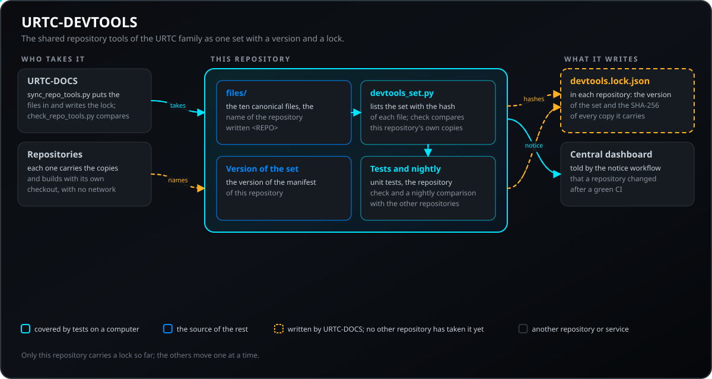
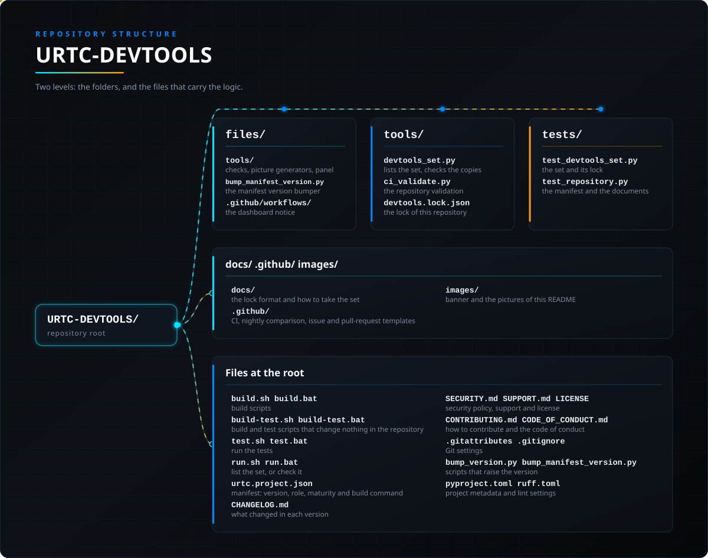

<p align="center">
  
</p>

# 🧰 URTC-DEVTOOLS

<p align="center"><a href="README.md">🇺🇸 English</a> | <a href="README_spa.md">🇪🇸 Español</a> | 🇫🇷 <b>Français</b> | <a href="README_ita.md">🇮🇹 Italiano</a> | <a href="README_deu.md">🇩🇪 Deutsch</a> | <a href="README_zho.md">🇨🇳 简体中文</a> | <a href="README_jpn.md">🇯🇵 日本語</a> | <a href="README_por.md">🇵🇹 Português</a></p>

### Les outils de dépôt communs de la famille URTC en un ensemble versionné, avec un fichier de verrou dans chaque dépôt

<p align="center">
  
  
  
  
  
  
</p>

---

**Contrôle d'honnêteté - ce qui fonctionne aujourd'hui :** ce dépôt contient les 14 fichiers que les dépôts de la famille portent comme la même copie, un petit outil qui les liste et contrôle les copies que le dépôt porte lui-même, des tests et de la documentation. Tout cela s'exécute et est testé en CI. Le fichier de verrou est écrit et contrôlé par URTC-DOCS ; pour l'instant seul ce dépôt en porte un, les autres n'ont pas encore pris l'ensemble, et rien ici n'a tourné sur du matériel.

---

## 📋 En un coup d'œil

| | |
|---|---|
| Version | `0.0.1` |
| Maturité | Ébauche |
| Tests | 28 (`python -m unittest discover -s tests`) |
| Technologie | Python / GitHub Actions / JSON |
| Cible | Le PC de la personne qui l'utilise |
| Sur matériel réel | Sans objet : rien ici ne s'exécute sur du matériel |

**Aller à :** [Présentation](#-présentation) · [Architecture](#-architecture) · [Démarrage rapide](#-démarrage-rapide) · [Tests](#-tests) · [Structure](#-structure-du-dépôt) · [Liés](#-projets-liés)

## 🚦 État du projet

🟢 fait et vérifié · 🟡 fonctionne, avec des limites connues · 🟠 à moitié fait ou non vérifié · 🔴 non fait ou non fonctionnel. Rien n'est vert si cela n'a jamais tourné sur du vrai matériel.

| Partie | État | Ce que le dépôt peut démontrer |
| --- | :---: | --- |
| Logiciel | 🟡 | L'ensemble, son listage et son contrôle ; exécuté seulement sur un ordinateur. |
| Tests | 🟡 | La suite de tests passe dans la CI à chaque push. |
| Sécurité | 🟠 | Le verrou garde des empreintes SHA-256 pour repérer une modification ou une copie en retard ; c'est un contrôle de cohérence, pas une signature. |
| Documentation | 🟡 | README en huit langues et format du verrou ; les traductions n'ont pas été relues par des locuteurs natifs. |

## 🎯 Présentation

Les outils que chaque dépôt de la famille porte comme la même copie, réunis en un seul endroit et dotés d'une version :

* [`files/`](files) : la copie canonique des 14 fichiers partagés (les contrôles de la politique de documentation et de la parité des README, les générateurs d'images, le panneau en direct des scripts de compilation, l'outil qui monte la version du manifeste, le contrôle des feux d'état et l'avis au tableau de bord). Le nom du dépôt est écrit `<REPO>` et remplacé quand un fichier est placé dans un dépôt.
* La **version de ce dépôt est la version de l'ensemble** ; le [journal des modifications](CHANGELOG.md) dit ce qui a changé à chaque version.
* Un **fichier de verrou** dans chaque dépôt, `tools/devtools.lock.json`, écrit par `tools/sync_repo_tools.py` d'URTC-DOCS : la version de l'ensemble et le SHA-256 de chaque copie. `tools/check_repo_tools.py` trouve une copie modifiée à la main et, quand ce dépôt est à côté des autres, une copie en retard. Voir [le format du verrou](docs/LOCK_FORMAT.md).
* Chaque dépôt reste compilable et contrôlable avec sa propre copie de travail : le verrou est un fichier du dépôt et rien n'a besoin du réseau.

## 🧩 Rôle dans URTC

URTC-DEVTOOLS est l'endroit où les outils communs reçoivent un nom et une version. Modifier l'un d'eux revenait à modifier une dizaine de dépôts sans que rien dise quelle version chacun portait ; maintenant l'ensemble a une version, chaque dépôt dit laquelle il a prise, et une copie modifiée ou en retard est signalée. Par lui-même il ne change rien dans les dépôts : URTC-DOCS place les fichiers et écrit les verrous, un dépôt à la fois.

## 🏛️ Architecture

<p align="center">
  
</p>

Comment les parties de ce dépôt s'articulent : qui prend l'ensemble, ce qu'il contient et ce qu'il écrit dans chaque dépôt. L'image est dessinée à partir de `docs/architecture.json` et vérifiée par rapport au code.

## 🚀 Démarrage rapide

**Prérequis :** Python 3.10 ou plus récent ; rien d'autre.

```bash
python tools/devtools_set.py list            # la version de l'ensemble et le SHA-256 de chaque fichier
python tools/devtools_set.py check           # les copies de ce dépôt sont les fichiers canoniques
python tools/tooling_registry.py check       # le registre des outils que les familles partagent : empreintes et sources identiques
python -m unittest discover -s tests         # les tests
python tools/sync_repo_tools.py --apply      # depuis URTC-DOCS : placer l'ensemble et les verrous dans les dépôts voisins
```

## 🧪 Tests

La suite compte 28 tests (`python -m unittest discover -s tests`). Ils vérifient que `files/` contient exactement les fichiers partagés, que chacun est valide et se génère avec le nom d'un dépôt, qu'une copie modifiée ou absente est trouvée, que le verrou de ce dépôt correspond à ses fichiers et à sa version, ainsi que le manifeste, le journal des modifications et les documents. Un test compare `files/` au modèle d'URTC-DOCS et s'ignore quand ce dépôt n'est pas à côté. La logique du verrou est testée dans URTC-DOCS.

## 🏗️ Compilation et publication

`build.sh` / `build.bat` montent la version de l'ensemble, contrôlent les copies et lancent les tests ; `build-test.sh` / `build-test.bat` contrôlent sans changer aucune version ; `run.sh` / `run.bat` listent l'ensemble. Une nouvelle version de l'ensemble se fait en changeant un fichier de `files/` et sa copie, en montant la version une fois pour tout le lot et en prenant l'ensemble dans les dépôts ; voir [le guide](docs/TAKING_THE_SET.md).

## 📂 Structure du dépôt

<p align="center">
  
</p>

<details>
<summary>Version texte de l'arborescence</summary>

```text
URTC-DEVTOOLS/
├── files/                                     les 14 fichiers canoniques, au chemin qu'ils ont dans chaque dépôt
├── tools/                                     le contrôle de l'ensemble, la validation du dépôt et les copies que porte ce dépôt
├── tests/                                     tests de l'ensemble, du verrou et du dépôt
├── docs/                                      le format du verrou et comment prendre l'ensemble
├── .github/                                   CI, comparaison nocturne, modèles de tickets et de pull requests
├── images/                                    bannière et images de ce README
├── build.sh build.bat                         scripts de compilation
├── build-test.sh build-test.bat               scripts de compilation et de test qui ne changent rien au dépôt
├── test.sh test.bat                           lancent les tests
├── run.sh run.bat                             listent l'ensemble ou le contrôlent
├── urtc.project.json                          manifeste : version, rôle, maturité et commande de build
├── CHANGELOG.md                               ce qui a changé à chaque version
├── SECURITY.md SUPPORT.md LICENSE             politique de sécurité, support et licence
├── CONTRIBUTING.md CODE_OF_CONDUCT.md         comment contribuer et code de conduite
├── .gitattributes .gitignore                  réglages de Git
├── bump_version.py bump_manifest_version.py   scripts qui montent la version
└── pyproject.toml ruff.toml                   données du projet et réglages du lint
```

</details>

## 🗺️ Feuille de route et limites connues

**Limites connues aujourd'hui**

* Le verrou est écrit et contrôlé par URTC-DOCS (`tools/sync_repo_tools.py` et `tools/check_repo_tools.py`) ; chaque dépôt de la famille en porte un désormais (`tools/devtools.lock.json`).
* URTC-DOCS garde encore son propre modèle, que lit le synchroniseur ; un test compare les deux quand ils sont côte à côte.
* Les fichiers qui existent aussi dans les projets frères ne sont pas déplacés ici seuls : le même fichier dans toutes les familles, ou aucun.
* Rien ici n'a tourné sur du matériel ; les outils fonctionnent sur un ordinateur.

**Prochaines étapes**

* Faire passer les dépôts de la famille au verrou un par un.
* Faire de ce dépôt la source que lit le synchroniseur et retirer le modèle d'URTC-DOCS.

## 🌍 Langues

Le README et les textes existent en anglais, espagnol, français, italien, allemand, chinois, japonais et portugais européen.

## 🔗 Projets liés

URTC est fait de dépôts indépendants, chacun avec sa version, ses tests et son README. Voici la famille, par groupes :

* **URTC Tool Platform:**
  * [URTC](https://github.com/JuanenRac/URTC) - firmware de la carte de la tête d'outil (25 profils d'outil, bootloader CAN) et référence du protocole CAN.
  * [URTC-COMMON](https://github.com/JuanenRac/URTC-COMMON) - le protocole CAN écrit une seule fois comme données (spécification, tables générées, vecteurs de conformité) et le code que les programmes partagent.
  * [URTC-FLASHER](https://github.com/JuanenRac/URTC-FLASHER) - outil de bureau qui met à jour le firmware de la carte par CAN ou par SWD/JTAG.
  * [URTC-GATEWAY](https://github.com/JuanenRac/URTC-GATEWAY) - passerelle devant le bus CAN : ne laisse passer que les identifiants d'une liste, limite leur cadence et demande une clé de session.
  * [URTC-SMART-RACK](https://github.com/JuanenRac/URTC-SMART-RACK) - logique C indépendante du matériel et protocole de commandes pour un support d'outils avec préchauffage et suivi du cycle de vie.
  * [URTC-TESTER](https://github.com/JuanenRac/URTC-TESTER) - testeur de bureau du bus CAN en direct qui affiche les commandes et la télémétrie du profil d'outil signalé par une carte.
  * [URTC-VISION-TOOL](https://github.com/JuanenRac/URTC-VISION-TOOL) - protocole de trames de capteur en C et compagnon Python thermique/RVB pour une tête d'outil d'inspection.
  * [URTC-WEB-STUDIO](https://github.com/JuanenRac/URTC-WEB-STUDIO) - application de navigateur qui flashe et teste la carte via Web Serial et SLCAN, sans rien installer.
* **Ecosystem Operations:**
  * **URTC-DEVTOOLS** (ce dépôt) - les outils de dépôt communs de la famille en un ensemble versionné, avec un fichier de verrou qui distingue une copie modifiée d'une copie en retard.
  * [URTC-DOCS](https://github.com/JuanenRac/URTC-DOCS) - architecture, interfaces, base de sécurité et catalogue généré de l'écosystème, plus les outils qui comparent tous les dépôts.
  * [URTC-UPDATER](https://github.com/JuanenRac/URTC-UPDATER) - outil de bureau qui détecte, installe et met à jour les dépôts de la famille URTC, une action explicite à la fois.

**Projets frères (indépendants, avec la même base et les mêmes outils) :**

* **[HYDRA-UMC-DOCS](https://github.com/JuanenRac/HYDRA-UMC-DOCS)** - projet frère : le centre de documentation de HYDRA-UMC, un écosystème indépendant qui partage la base et les outils de celui-ci
* **[ARMOR-DOCS](https://github.com/JuanenRac/ARMOR-DOCS)** - projet frère : le centre de documentation d'A.R.M.O.R., l'écosystème de sécurité, lui aussi indépendant et construit sur la même base
* **[JuanenRac](https://github.com/JuanenRac/JuanenRac)** - le profil et le tableau d'état de tous les écosystèmes

## 📚 Documentation

Pour en savoir plus :

* [Le format du verrou et ce qui est contrôlé](docs/LOCK_FORMAT.md)
* [Prendre l'ensemble et faire une nouvelle version](docs/TAKING_THE_SET.md)
* [Journal des modifications de ce dépôt](CHANGELOG.md)
* [Licence (GPL-3.0-or-later)](LICENSE)
* Questions, idées et rapports : electrohobby3d@gmail.com

## 🤝 Contribuer et communauté

* Avant une pull request, lancez `URTC_CI=1 python tools/ci_validate.py` : il doit réussir. Voir [CONTRIBUTING.md](CONTRIBUTING.md) et le [code de conduite](CODE_OF_CONDUCT.md).
* Le README existe en huit langues : une modification du texte se fait dans les huit fichiers.
* Ne décrivez pas comme fonctionnant sur une carte ce qui a seulement été compilé.
* Signalez une vulnérabilité en privé : [SECURITY.md](SECURITY.md). Questions, idées et rapports : electrohobby3d@gmail.com ([SUPPORT.md](SUPPORT.md)).

## 👤 AUTEUR

**JuanenRac (Electro Hobby 3D)** · electrohobby3d@gmail.com

## 📜 LICENCE

GPL-3.0-or-later - voir [LICENSE](LICENSE).
